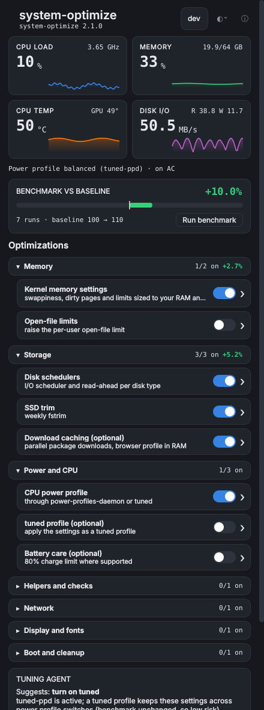
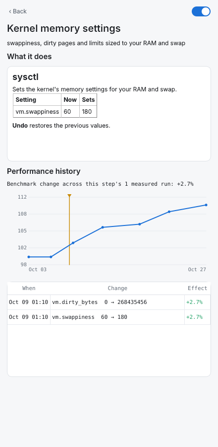
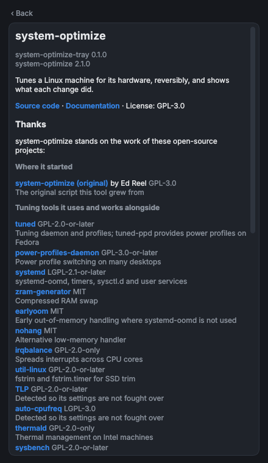

# system-optimize-tray

A tray icon and dashboard for `system-optimize`. It shows what the machine is
doing (CPU, memory, temperatures, disk I/O, power profile), what
system-optimize has changed, and whether each change made the benchmark
better or worse. Every change goes through `system-optimize` itself, behind a
polkit password prompt, and can be undone.

| Dashboard | A step's page | About |
|---|---|---|
|  |  |  |

## What you get

- **Live tiles** for CPU load, memory, CPU temperature and disk I/O, each with
  a sparkline, plus the power profile and which daemon owns it.
- **Benchmark against your baseline**: your first benchmark is the baseline;
  each later run shows the change.
- **A switch per tuning step**, grouped into categories (Power and CPU,
  Memory, Storage, Network, Display and fonts, Boot and cleanup, Helpers and
  checks). Categories start collapsed and show "n/m on" and the benchmark
  change measured after their changes; the panel remembers which ones you
  opened.
- **A page per step**: what it does and which settings it changes (from
  `system-optimize --describe`), a chart of benchmark scores over time with
  this step's changes marked, and a change log with the measured effect of
  each change.
- **Light, dark or system** theme. System follows the desktop live.
- **About**, which credits the open-source projects system-optimize builds
  on (one list, `data/credits.json`, kept in step with `docs/tools.md` by a
  test).
- **An optional local tuning agent** (below).

## GNOME, KDE and the rest

| Desktop | What shows up |
|---|---|
| KDE Plasma, Xfce, LXQt, Cinnamon, MATE, Budgie | A tray icon (StatusNotifierItem). Left click opens the panel, right click has Preview, Undo and Quit. |
| GNOME 45 to 51 | GNOME has no tray. Install the **GNOME Shell extension** for a native panel menu: live readings in the top bar, categories as submenus with a switch per step, Apply all, Undo, profiles, benchmark, and "Open dashboard…" for the full panel. |
| GNOME with AppIndicator (Ubuntu) | Either works. When the extension is enabled the tray app steps aside so you don't get two icons (`--force` overrides). |
| Anything else | `system-optimize-tray --panel` opens the dashboard as a window. |

The extension and the tray app read the same settings file, so the theme you
pick applies to both.

## Install

Fedora (RPM) and Debian or Ubuntu (deb) packages are built by CI from
`packaging/`:

- `system-optimize-tray`: the tray app, dashboard, root helper and polkit policy
- `gnome-shell-extension-system-optimize`: the GNOME panel menu (then
  `gnome-extensions enable system-optimize@bradvrudney.github.io` and log out and in)
- `system-optimize-agent`: the optional tuning agent

From a checkout:

```
sudo make -C tray install            # everything
sudo make -C tray install-tray       # or one part: install-extension, install-agent
```

It needs Python 3 and either PySide6 or PyQt6 (`sudo dnf install
python3-pyside6` on Fedora). The extension's menu needs only Python; the
dashboard it opens needs Qt.

## How changes are made

The tray runs as you. Reading needs no privileges: the readings come from
`/proc` and `/sys`, and the steps, history and docs come from
`system-optimize --status --json`, `--history --json` and `--describe`.

Changing something runs `pkexec /usr/libexec/system-optimize/system-optimize-helper`,
which polkit lets an active local admin run after a password prompt (kept for
a few minutes, like sudo). The helper is the only part that runs as root. It:

- accepts a fixed list of actions (`apply-all`, `apply`, `enable`, `revert`,
  `undo`, `profile`, each optionally `--safe`) and step names matching
  `^[a-z][a-z0-9-]{0,31}$`, up to 32 of them;
- runs only a `system-optimize` that root owns and nobody else can write to,
  checking the file, every directory above it and its `lib/`;
- runs it with a fixed, minimal environment, never yours.

## What it needs from system-optimize

The tray reads `capabilities` from `system-optimize --status --json` and
turns off what the installed version can't do, with a tooltip saying why:

| Capability | Used for |
|---|---|
| `undo` | Undo last run |
| `enable` | turning on optional steps (`--enable STEP`) |
| `revert-step` | switching one step off (`--undo --only STEP`); without it, the tooltip points at Undo |
| `profile` | the profile chip and profile menu |
| `benchmark` | Run benchmark (`--benchmark-only --json`) |
| `history` | scores and change logs (`--history --json`, readable as a normal user) |
| `describe` | step pages (`--describe STEP --json`); otherwise the step's section of `--help` |
| `safe-apply` | agent proposals are applied with `--safe-apply` |

With system-optimize 2.0.0, which has none of the JSON output yet, the tray
still shows the live readings and the step list from `--help`, and Apply all,
Preview and Undo work; the switches show "state unknown".

## The tuning agent (optional)

The agent runs a small local model, by default **qwen3:4b** through Ollama,
once a day. It looks at system-optimize's status and benchmark history and
may suggest one change: turn a step on or off, switch profile, or undo the
last run. It can only call five tools (status, step list, history, benchmark,
propose), and a proposal must name a real step or profile. **It never applies
anything itself.** The suggestion waits in the dashboard's agent card (and
arrives as a desktop notification) until you press Apply, which goes through
the same password prompt as any other change, with `--safe-apply`.

You can also ask it questions from the dashboard or its chat page.

Set it up for your user:

```
/usr/share/system-optimize-tray/install-agent.sh                   # qwen3:4b, daily
/usr/share/system-optimize-tray/install-agent.sh --model qwen3:8b --schedule "0 3 * * *"
/usr/share/system-optimize-tray/install-agent.sh --install-ollama  # installs Ollama with dnf, pacman or zypper
/usr/share/system-optimize-tray/install-agent.sh --uninstall [--remove-model]
```

**Memory:** the 4B model needs about **3 to 3.5 GB of RAM** while it runs. A
scheduled run unloads it when it finishes; a chat keeps it loaded for
`AGENT_KEEP_ALIVE` (5 minutes). The installer warns below 6 GB of RAM and 3.5
GB of free disk.

Change the model any time with `system-optimize-agent model NAME` (then
`ollama pull NAME`), or in the chat page's model picker. The schedule is a
cron expression or `@daily`, `@weekly`, `@hourly`; it becomes a systemd user
timer (`Persistent=true`, so a run missed while the laptop slept happens at
the next boot), or a crontab line where there is no systemd user session.

```
system-optimize-agent check            # is the model server up, is the model there, next run
system-optimize-agent ask "why is my disk score down?"
system-optimize-agent proposal         # what it suggested
system-optimize-agent approve          # apply it (password prompt)
system-optimize-agent schedule off
```

Settings live in `~/.config/system-optimize/agent.conf` (over
`/etc/system-optimize/agent.conf`), `KEY=value`, parsed and never sourced:

| Key | Default | |
|---|---|---|
| `AGENT_MODEL` | `qwen3:4b` | any model your server has |
| `AGENT_BACKEND` | `ollama` | or `llamacpp` (any OpenAI-compatible server) |
| `AGENT_URL` | `http://127.0.0.1:11434` | `:8080` for llamacpp |
| `AGENT_SCHEDULE` | `@daily` | cron expression, or `off` |
| `AGENT_BENCHMARK` | `1` | let a scheduled run benchmark first |
| `AGENT_NOTIFY` | `1` | desktop notification for a new suggestion |
| `AGENT_KEEP_ALIVE` | `5m` | how long chat keeps the model loaded |

Applying suggestions without asking is deliberately not built: it would need
a polkit rule that lets the agent change the system with no password. That
is your call to make, and it is a few lines in `/etc/polkit-1/rules.d/` if
you ever want it.

## Settings

`~/.config/system-optimize/tray.conf`, shared with the GNOME extension:

| Key | Default | |
|---|---|---|
| `THEME` | `system` | `light`, `dark` or `system` (also in the panel's ◐ menu) |
| `EXPANDED` | empty | categories you opened, e.g. `memory,storage` |

## Development

```
make -C tray test        # Python unit tests (Qt ones run offscreen, skip without Qt) and the extension's node tests
make -C tray lint
make -C tray screenshots # renders the panel with a fake system-optimize into tray/screenshots-out
```

The tests use a fake `system-optimize` (`tests/fixtures/fake-system-optimize`),
a fake `/proc` and `/sys`, and a fake Ollama server; nothing touches the real
system. Override the CLI with `SO_TRAY_CLI=/path/to/system-optimize`.
